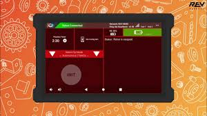
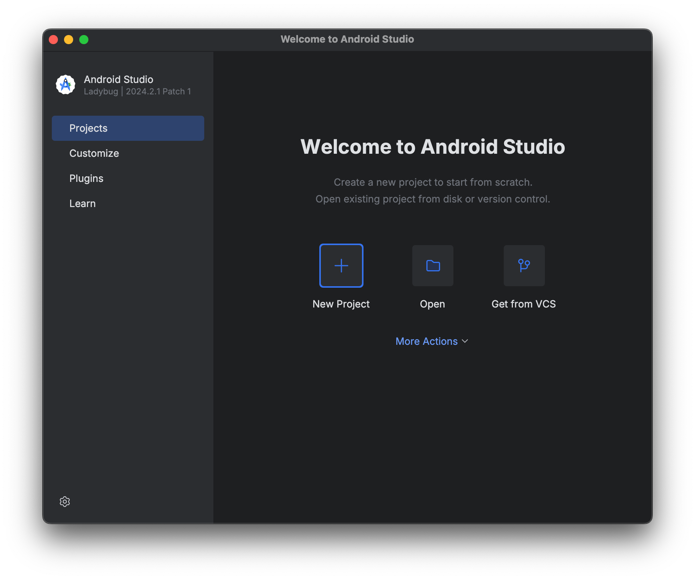

# Guide to Using the Code from FTC Team 24751
## Hello everyone! To operate our FTC team's bamboo bot, below is a complete, detailed step-by-step guide to:
### 1.	Get the code from the GitHub repo
### 2.	Clone / Import it as an Android Studio project
### 3.	Paste the URL to sync the project with GitHub
### 4.	Upload the code to the FTC Control Hub
### 5.	Control the robot

## I.	DOWNLOAD OR CLONE THE REPO FROM GITHUB

### Method 1 — Clone using the URL (Recommended)
1.	Open the repo:
https://github.com/greenamsroboticsteam/Bamboo-bot-24751
2.	Click the green Code button → Copy the HTTPS URL.
3.	Open Android Studio → Get from VCS.
4.	Paste the URL → Choose a folder to save it in → Clone.

________________________________________
### Method 2 — Download ZIP
1.	On the repo page → click Code → Download ZIP.
2.	Extract the ZIP file.
3.	Open Android Studio → Open → select the extracted folder.
II. IMPORT THE FTC PROJECT INTO ANDROID STUDIO

#### Once you have cloned the repo or opened the ZIP:
1.	Android Studio will automatically detect Gradle and build the project.
2.	Wait for the Gradle "Sync" to finish. This usually takes about 15 seconds; during that time you should not open or edit any files.
3.	Check the folder tree to make sure it has the standard FTC structure:
4.	Your robot code will be located in:
III.	Use Android Studio to link the project to GitHub. (optional)
       1.  Go to File → Settings → Version Control → Git (if you need to check).
2.  Go to VCS → Enable Version Control Integration → Git.
3.  Go to Git → Manage Remotes → paste your GitHub URL.
4.  Commit & Push when needed.
IV. Set up the robot's name in the Control Hub
To run the robot using JAVA code, you need a Driver Station (Driver Hub) and a Control Hub (you can add an Expansion Hub if needed). Then follow these steps:

1.	First, rename the Driver Station and the Control Hub so they comply with the FTC competition rules (for example, if your team number is 24751, name them 24751-DS and 24751-RC respectively). Detailed competition rules: https://ftc-resources.firstinspires.org/ftc/game/manual
2.	Next, select the Control Hub's local network (after the Control Hub has been activated) and change its password (the network name is usually FTC - |team number|)

3.	Next, tap the "3 dots" in the top-right corner and tap Configure Robot.

4.	In Configure Robot, tap the "new" button and then tap Control Hub Portal. Here you will see all the types of subsystems that the Control Hub supports.

5.	Next, select each type of subsystem used on your bot (motor, servo, IMU, …), choose the correct product, and finally enter a name for each subsystem. Each subsystem corresponds to the port with the same number on the Control Hub when connected.

### Note: Choose names that are easy to remember and accurately describe each subsystem's function. Also, in the code, edit the name of each subsystem so that it matches the name in the Driver Station.
6.	Once you have completed the steps above, tap done and save to store the data in the Driver Station. After tapping save, you will be asked to enter a name for your Configuration; you can name it however you like.
7.	To use the Configuration you created above, tap the activate button under its name. If you want to edit it, tap the edit button, and to delete it, tap Delete.

8.	After tapping Activate, tap the outward-pointing arrow button and you will see the message "restarting robot". Wait a few seconds for the Driver Station to finish.
You can refer to the detailed tutorial in the following video:
https://www.youtube.com/watch?v=x2Gi-i6Z2pI

## II. IMPORT THE FTC PROJECT INTO ANDROID STUDIO

### Once you have cloned the repo or opened the ZIP:
1.	Android Studio will automatically detect Gradle and build the project.
2.	Wait for the Gradle "Sync" to finish. This usually takes about 15 seconds; during that time you should not open or edit any files.
3.	Check the folder tree to make sure it has the standard FTC structure:
4.	Your robot code will be located in:
## III.	Use Android Studio to link the project to GitHub. (optional)
1.  Go to File → Settings → Version Control → Git (if you need to check).

2.  Go to VCS → Enable Version Control Integration → Git.
3.  Go to Git → Manage Remotes → paste your GitHub URL.
4.  Commit & Push when needed.

## IV. Set up the robot's name in the Control Hub
### To run the robot using JAVA code, you need a Driver Station (Driver Hub) and a Control Hub (you can add an Expansion Hub if needed). Then follow these steps:

1.  First, rename the Driver Station and the Control Hub so they comply with the FTC competition rules (for example, if your team number is 24751, name them 24751-DS and 24751-RC respectively). Detailed competition rules: https://ftc-resources.firstinspires.org/ftc/game/manual
2.	Next, select the Control Hub's local network (after the Control Hub has been activated) and change its password (the network name is usually FTC - |team number|)

3.	Next, tap the "3 dots" in the top-right corner and tap Configure Robot.

4.	In Configure Robot, tap the "new" button and then tap Control Hub Portal. Here you will see all the types of subsystems that the Control Hub supports.

5.	Next, select each type of subsystem used on your bot (motor, servo, IMU, …), choose the correct product, and finally enter a name for each subsystem. Each subsystem corresponds to the port with the same number on the Control Hub when connected.

### Note: Choose names that are easy to remember and accurately describe each subsystem's function. Also, in the code, edit the name of each subsystem so that it matches the name in the Driver Station.
6.	Once you have completed the steps above, tap done and save to store the data in the Driver Station. After tapping save, you will be asked to enter a name for your Configuration; you can name it however you like.

7.	To use the Configuration you created above, tap the activate button under its name. If you want to edit it, tap the edit button, and to delete it, tap Delete.

8.	After tapping Activate, tap the outward-pointing arrow button and you will see the message "restarting robot". Wait a few seconds for the Driver Station to finish.

### You can refer to the detailed tutorial in the following video: https://www.youtube.com/watch?v=x2Gi-i6Z2pI

## V. UPLOAD THE CODE TO THE CONTROL HUB / ROBOT CONTROLLER
### Method A — USB to the Control Hub
1.	Connect a USB-A cable from the computer that has the code to the USB-C port on top of the Control Hub. The computer will detect the connection and show the message "Control Hub connected" in the bottom-right corner.
2.	Android Studio recognizes the device as an Android device.
3.	To upload the code to the Control Hub, click the arrow (Run) button at the top of the Android Studio interface.

4.	Then wait about 30 seconds for the code to be uploaded to the Control Hub.
### Method B — Use an Android phone as the Robot Controller
1.	Install the FTC Robot Controller app from the SDK (or from Google Play if permitted).
2.	Plug the phone into your PC via USB.
3.	Upload the code the same way as in Method A.
### Note: If you choose Method B, make sure your phone runs the Android operating system. Also, most phones in use today are not allowed in official competitions, so Method A is still the most convenient option.
## VI. TEST THE CODE IN THE DRIVER STATION
1.  Turn on the Control Hub.
2.  Turn on the phone or the Driver Station.
3.  Wait for the WiFi connection between the DS ↔ Control Hub.
4.  In the Driver Station → OpModes tab, you will see the OpModes you have written (for example: TeleOp for manual control, Autonomous for the autonomous period).
5.  Select an OpMode → press INIT → when ready, press START.
6.  The robot will run exactly the code you uploaded.
7.  If you want to stop all of the robot's activity, press the square button on the DS once more (in the same position as INIT and START).

## VII. The subsystems and TeleOps needed to operate our bamboo bot.

### We have included many files and folders to help you easily control, debug, or modify some of the bamboo bot's mechanisms, as follows:

1. Drivebase and Drivebase_Test: Only include movement control for the bot (also called the drivebase).
2. Flywheel and Flywheel_Test: Only include control for the ball-shooting mechanism (flywheel).
3. Motor_Basic and Motor_Test: Basic control of a single motor.
4. Servo_Basic and Servo_Test: Basic control of a single servo.
5. starterbot: The main control code for the entire bamboo bot. The controls (on the gamepad) are:
- right bumper: intake mechanism; press once to start taking in balls, press again to stop the intake;
- right trigger: ball-release mechanism (spins the intake in reverse); hold to release balls, let go to stop the intake;
- dpad up: short-range shooting (Power = 1.0), just press once;
- dpad down: long-range shooting (Power = 1.0), just press once;
- Square button (gamepad.x): hold to open the ball blocker and push balls up to the flywheel;
- right stick (right_stick): drive forward and backward;
- left stick (left_stick): rotate the bot;

## VIII. How to control the bamboo bot.
### After you have pressed INIT and START, follow these steps to control the bamboo bot:
- To move, push the right joystick (right_stick) up and down to drive the robot forward and backward, and push the left joystick (left_stick) left and right to rotate the bot.
- Press left_bumper to turn the flywheel on / off, and press the up / down buttons (dpad up / down) to increase / decrease the flywheel speed.
- Press right_bumper to turn the intake on / off, and hold right_trigger to enable ball-release mode (spin the intake in reverse).
- When you want to push balls up to the flywheel, turn off the intake first (by pressing right_bumper), then hold the square button on the left side of the controller to both feed the balls and open the block (ball blocker).

### Also, for the Autonomous period of FTC, you only use the code file named AutoOp.java, and the bot will run along a fixed path on its own.
                                   --- The end ---
